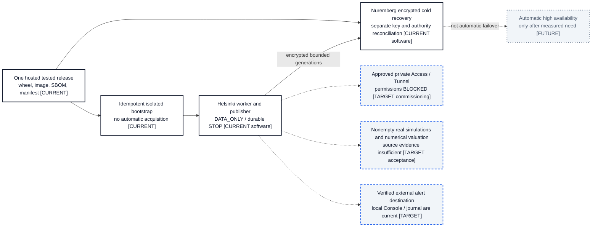

# Deployment Evolution and Acceptance

- **Diagram ID:** PSA-ARCH-14
- **Purpose:** Separate implemented process boundaries from operational acceptance.
- **Scope:** Hosted artifacts, Helsinki, private Console and Nuremberg cold recovery.
- **Architecture status:** MIXED
- **Audience:** Operators, developers and security reviewers.
- **Source commit:** `4f3b611adae17defbcc6e24b4f9f917b466d5ad8`
- **Reviewed:** 2026-10-19

## Mermaid diagram

Canonical source: [`14-target-deployment-view.mmd`](../sources/14-target-deployment-view.mmd)

## Reading and evidence

CURRENT software is verified in the package and tests; it is not a claim that
all host services or public access are commissioned. The [dated execution record](../../../18-ai-handoffs/platform-independent-shadow-2026-10-16.md)
owns operational receipts; a runtime query owns live state. The [runbook](../../../10-operations/independent-platform-shadow.md)
owns release, STOP, recovery and rollback actions. Unrelated services are
preserved. Old topology snapshots are dated
evidence, not the authority for new activation.

## Boundaries and limitations

The web process has no financial mount or Docker socket. Only the worker applies
validated control receipts under durable authority. Report windows do not reset
capital or force financial-session closure. Backup upload cannot decrypt. Recovery
starts isolated and disabled; stale counters never authorize resumed acquisition.
Access permissions, nonempty numerical usefulness and owner comprehension each
need separate actual receipts. No profitability, Live authority, active/active
operation or automatic failover is implied.

## Implementation and tests

`deploy/platform_bootstrap.py`, `deploy/platform_backup.py`,
`src/polysia/cli_commands/platform_worker.py`, `src/polysia/deployment/platform_recovery.py`,
`src/polysia/monitoring/console.py`, `tests/unit/deployment/test_platform_bootstrap.py`,
`tests/browser/test_console_browser.py`, `tests/integration/test_continuous_shadow_portfolio.py`.
ADR-0021 records ownership. Review on any process, state, identity, host, release,
network or recovery-boundary change.
